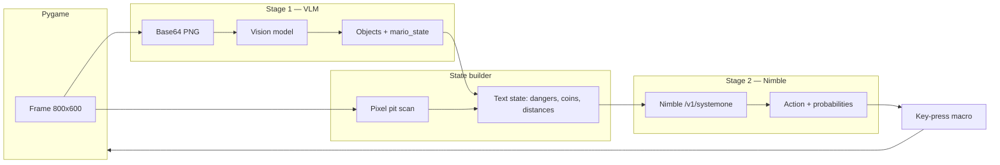

# Mario Jev

A mini Super Mario–style platformer in Python and Pygame, plus an optional **vision agent** that watches the game window and plays (or advises) using a **two-model stack**: a vision-language model (VLM) for perception and **Nimble** for fast, typed decisions.


---

## What’s in this repo

| File | Purpose |
|------|---------|
| `mario_game.py` | Standalone game — human controls only |
| `mario_vlm.py` | Game + VLM perception + Nimble (or rules) policy |
| `notebooks/01_mario2gemma.ipynb` | Step-by-step notebook for frame capture, VLM, and Nimble |
| `notebooks/frames/t1.png` | Example in-game screenshot |

---

## Game design

`mario_game.py` implements a side-scrolling level inspired by classic Mario:

- **World:** 800×600 viewport, ~4000 px wide level, parallax hills and clouds, brown ground with **gaps (pits)**, green **pipes**, floating **bricks** and **? blocks**, a **flag** at the end.
- **Player:** Mario with momentum-based movement, variable jump height, stomp on Goombas, bump ? blocks for coins.
- **Enemies:** Goombas patrol platforms and turn at edges/walls.
- **Collectibles:** Coins in the air and from ? blocks; score, coin count, and lives in the HUD.
- **States:** `playing`, `won`, `gameover`; **R** restart, **Esc** quit.

**Controls (human play):**

| Input | Action |
|-------|--------|
| Left / Right or A / D | Move |
| Space / Up / W | Jump |
| R | Restart level |
| Esc | Quit |

---

## Agent design: VLM + Nimble (two stages)

The agent in `mario_vlm.py` splits **seeing** from **choosing**. That keeps decision latency low: Nimble does not look at pixels; it only reads a short text **state** built from the VLM output.



### Stage 1 — VLM (perception)

Each turn:

1. The current frame is encoded as PNG and sent to a **vision model**.
2. The model returns structured JSON:
   - **objects:** labels (`mario`, `goomba`, `pipe`, `coin`, `question_block`) with bounding boxes
   - **mario_state:** one sentence (on ground / in air, what’s in front)
3. **Pits** are detected separately by scanning the bottom row of the frame for sky colour (VLMs often miss ground gaps).

**Default backend:** [OpenRouter](https://openrouter.ai/) with `google/gemini-3.1-flash-lite` (needs `OPENROUTER_API_KEY`).  
**Alternative:** local Ollama `qwen2.5vl:7b` via `--vlm-backend ollama` (slower on small GPUs).

### Stage 2 — Nimble (decision, fast)

[Nimble](https://ollama.com/library/nimble) is a 9B **decision model** from Bespoke Labs (fine-tuned from Qwen3.5-9B). It runs through Ollama’s **`/v1/systemone`** API:

- You pass a **state** (text or JSON) and **questions** with fixed answer choices.
- Nimble scores each allowed answer and returns **probabilities** — no long chain-of-thought, so decisions are typically **sub-second to a few seconds** once the model is loaded (vs ~10+ s per frame for a local 7B VLM on the same machine).

The agent asks one **choice** question: pick among moves such as `right`, `jump_right`, `run_jump`, `collect_coin`, `jump`, `left`, `stay`. Instructions tell Nimble to **avoid danger first**, **collect reachable coins second**, then progress right.

A small **rules policy** (`--policy rules`) skips Nimble and uses hand-written logic for debugging.

### Agent modes

| Mode | Behaviour |
|------|-----------|
| `auto` | Game pauses while models think; then runs the chosen action as a short key macro |
| `advise` | You play; VLM + Nimble run in a background thread and show suggested action on screen |

By default, **bounding boxes are not drawn** on the window (cleaner look). Use `--show-boxes` for debugging.

---

## Setup

Recommended: **conda** environment `mujoco` (or any Python 3.12+ env).

```bash
cd /mnt/e/Work/robotics/mario-jev
conda activate mujoco
pip install -r requirements.txt
```

### For the AI agent

1. **OpenRouter (VLM, default)**  
   ```bash
   export OPENROUTER_API_KEY="your-key-here"
   ```

2. **Ollama (Nimble, required for `--policy nimble`)**  
   ```bash
   ollama pull nimble:latest
   ollama serve   # in a separate terminal
   ```

   Optional local VLM:
   ```bash
   ollama pull qwen2.5vl:7b
   ```

---

## How to launch

### Without VLM — play the game yourself

No API keys, no Ollama. Only Pygame:

```bash
conda activate mujoco
python mario_game.py
```

### With VLM + Nimble — AI agent

**Auto-play:**

```bash
conda activate mujoco
export OPENROUTER_API_KEY="your-key-here"
# ollama serve  (must be running)
python mario_vlm.py --mode auto
```

**You play, agent advises:**

```bash
python mario_vlm.py --mode advise
```

**Useful flags:**

```bash
# Headless batch run (saves frames + log.jsonl)
python mario_vlm.py --mode auto --headless --steps 40 --out runs/test

# Local VLM instead of OpenRouter
python mario_vlm.py --vlm-backend ollama --vlm qwen2.5vl:7b

# Different OpenRouter vision model
python mario_vlm.py --vlm google/gemma-4-26b-a4b-it

# Rules-only policy (no Nimble)
python mario_vlm.py --policy rules

# Show VLM debug boxes on screen
python mario_vlm.py --mode auto --show-boxes
```

**Notebook walkthrough:**

```bash
jupyter notebook notebooks/01_mario2gemma.ipynb
```

Set `OPENROUTER_API_KEY` and have `ollama serve` running before cells that call Nimble.

---

## Architecture notes

- **Turn-based agent:** One perception + decision cycle per macro (walk/jump/sprint), not real-time 60 FPS AI.
- **Coordinate spaces:** OpenRouter VLMs usually return boxes on a 0–1000 grid; the code maps them to 800×600 screen pixels. Ollama Qwen2.5-VL uses a different internal resolution — see `BBOX_SPACE` in `mario_vlm.py`.
- **VRAM:** On an 8 GB GPU, Nimble (~10 GB) may split CPU/GPU; keeping Qwen on OpenRouter avoids swapping two large models locally.

---

## References

- [Nimble on Ollama](https://ollama.com/library/nimble) — decision models and `/v1/systemone`
- [OpenRouter](https://openrouter.ai/) — hosted vision models for Stage 1
